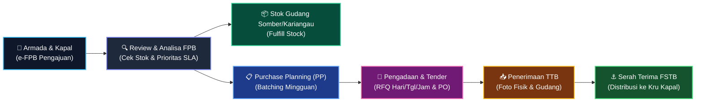
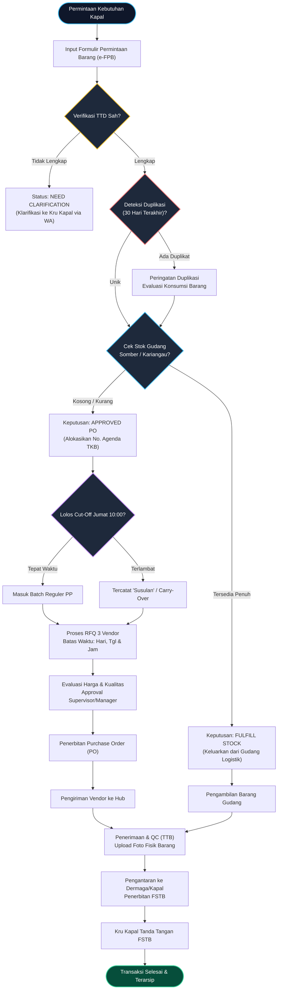
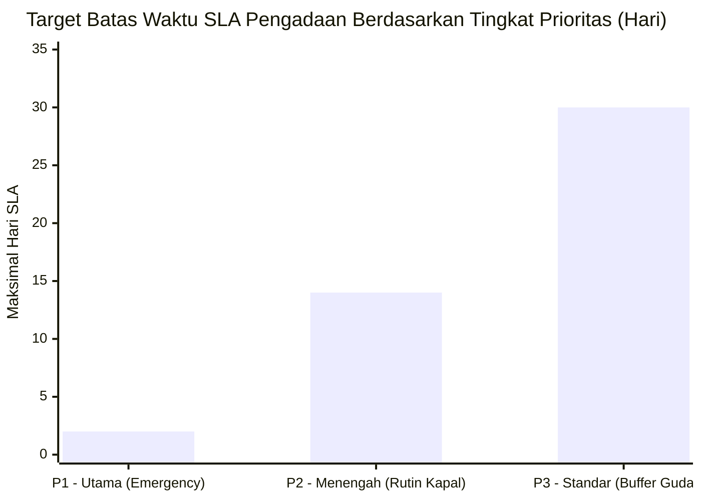
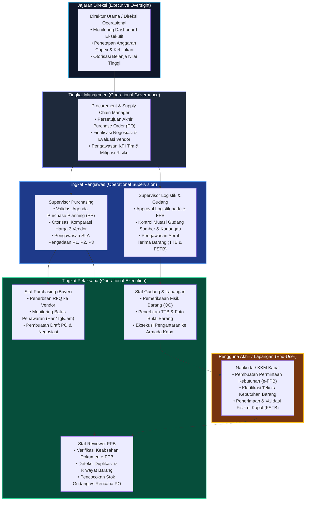
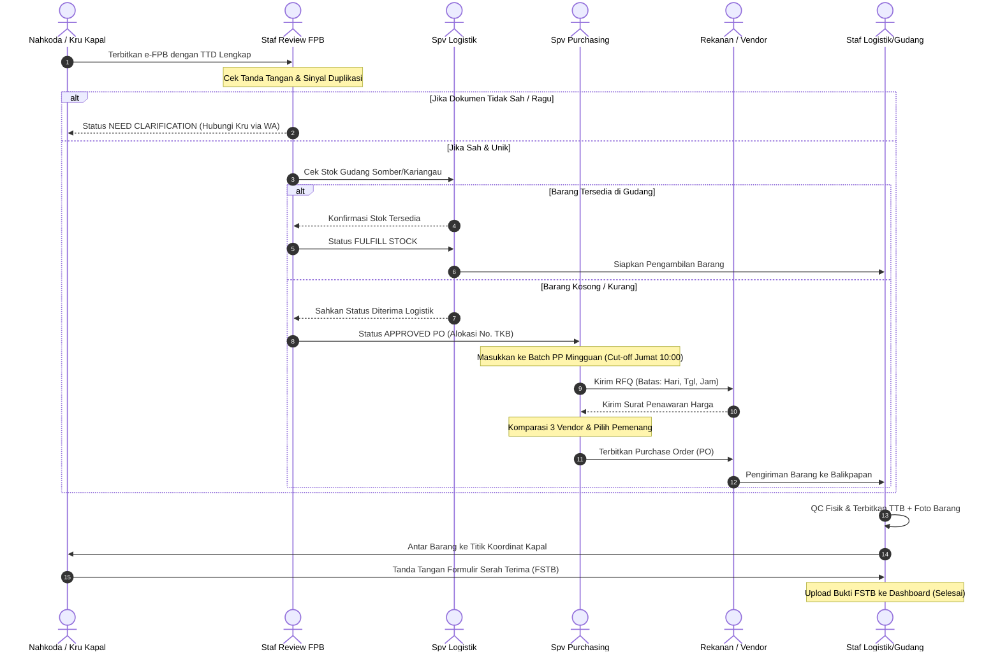

# LAPORAN TATA KELOLA & BAHAN PRESENTASI MANAJEMEN
## Dashboard Pengadaan, Logistik, dan Armada Terintegrasi CPG
**Evaluasi 1 Bulan Pasca Deployment & Standarisasi Prosedur Operasional**

---

> [!NOTE]
> **Tujuan Dokumen**: Disiapkan sebagai panduan komprehensif presentasi kepada jajaran Direksi dan Manajemen. Dokumen ini merangkum pencapaian sistem selama 1 bulan masa operasional, struktur tata kelola (*procurement governance*), standar operasional prosedur (SOP), rantai komando (*chain of command*), struktur organisasi, serta slide deck siap saji dalam format PowerPoint / PDF.

---

## 1. Executive Summary: Evaluasi 1 Bulan Pasca Deployment

Dalam kurun waktu lebih dari satu bulan sejak sistem ini diimplementasikan, platform **CPG Integrated Procurement & Logistics Dashboard** telah mentransformasi proses pengadaan barang dan logistik armada dari metode manual/tercecer menjadi ekosistem digital terpadu, transparan, dan akuntabel.

### 1.1 Transformasi Proses: Sebelum vs. Sesudah Deployment

| Parameter Evaluasi | Sebelum Deployment (Manual & Konvensional) | Setelah Deployment (Dashboard Terintegrasi) |
| :--- | :--- | :--- |
| **Penerimaan Permintaan (FPB)** | Melalui chat WhatsApp/kertas terpisah, sering hilang, nomor ganda. | Terpusat di *Review & Analisa FPB*, verifikasi otomatis tanda tangan e-FPB. |
| **Pencegahan Pembelian Ganda** | Sangat sulit dilacak; barang serupa sering dibeli berulang dalam 1 bulan. | Algoritma *Duplicate Detection* otomatis memberi sinyal peringatan jika ada pengajuan serupa. |
| **Pemanfaatan Stok Gudang** | Stok di Gudang Somber & Kariangau tidak termonitor real-time; langsung terbit PO baru. | *Stock-First Policy*: Sistem otomatis memeriksa ketersediaan stok sebelum masuk antrean beli. |
| **Siklus Pembelian (Planning)** | Sporadis, tanpa batas waktu (*cut-off*), menyulitkan negosiasi harga volume. | Siklus Mingguan Terstandar (*Weekly Batch Cut-Off* setiap Jumat pk 10:00). |
| **Batas Waktu Penawaran (RFQ)** | Batas penawaran tidak tegas; vendor terlambat tetap diterima tanpa standar. | Penetapan tegas: **Hari, Tanggal, dan Jam Penutupan Penawaran** yang jelas dan mengikat. |
| **Visibilitas Penerimaan Barang** | Tidak ada bukti fisik real-time saat barang tiba di pelabuhan/gudang. | Modul *Galeri TTB* dengan foto fisik barang, geotagging, dan penandatangan digital. |
| **Rantai Dokumen (Traceability)** | Riwayat FPB, PO, FSTB, dan TTB terputus di masing-masing folder. | *Doc Relation Resolver*: 1-klik untuk melihat seluruh silsilah transaksi dokumen. |
| **Kontrol Administrasi** | Kesalahan input nomor atau pengujian sistem sulit dibersihkan. | Fitur *Admin-Only FPB Void & Delete* dengan audit trail dan validasi transaksi downstream. |

---

## 2. Peta Arsitektur & Konten Web (Modul Inti)

Sistem ini dirancang berbasis siklus rantai pasok maritim terpadu yang memayungi 8 entitas operasional CPG: **CPL, PPI, HL, GAJ, MIL, SP, SSK, dan MO**.



### 2.1 Enam Pilar Modul Utama:

1. **Review & Analisa FPB (Hulu Permintaan)**:
   - Validasi dokumen e-FPB dari kapal beserta tanda tangan berjenjang (Pembuat, Reviewer, Approver).
   - Penentuan SLA & Prioritas:
     - **P1 (Utama)**: SLA 1–2 hari (Urgensi Darurat / Emergency Kapal).
     - **P2 (Menengah)**: SLA 3–14 hari (Perbaikan rutin & operasional).
     - **P3 (Rutin)**: SLA 14–30 hari (Stok buffer & persediaan umum).
   - Cek silang stok gudang otomatis (*Stock Matcher*).
   - Fitur *Clean Sheet* dan *Carry-Over Backlog* untuk menjaga kedisiplinan siklus mingguan.
   - Fitur Pembatalan (*Void / Salah Administrasi*) dan Penghapusan Permanen oleh Admin.

2. **Purchase Planning (Perencanaan Pengadaan Mingguan)**:
   - Pengelompokan berkas FPB yang disetujui ke dalam kode Batch resmi (misal: Batch III / Minggu ke-7).
   - Penomoran Agenda Planning (TKB).
   - Ekspor lembar kerja Excel 3-Tab terstandarisasi untuk negosiasi vendor.

3. **Pengadaan, Pratender & Tender (Sourcing & PO)**:
   - Manajemen RFQ (*Request for Quotation*) ke 3 vendor pembanding.
   - Penegasan batas penawaran dengan **Hari, Tanggal, dan Jam Penutupan** (misal: *Jumat, 20 Februari 2026 pk 17:00 WITA*).
   - Tracking komparasi harga dan penerbitan nomor PO (*Purchase Order*).

4. **Logistik, Gudang & Penerimaan (TTB & FSTB)**:
   - Manajemen persediaan Gudang Somber dan Gudang Kariangau.
   - Registrasi Tanda Terima Barang (TTB) lengkap dengan foto fisik barang dan surat jalan vendor.
   - Penerbitan Formulir Serah Terima Barang (FSTB) ke kapal dengan verifikasi digital.

5. **Armada, Posisi & Awak Kapal (Operasional Maritim)**:
   - Master data armada kapal tunda (*tugboat*) dan tongkang (*barge*).
   - Monitoring posisi kapal untuk sinkronisasi titik serah terima barang di pelabuhan Balikpapan / Samarinda.
   - Direktori kontak WhatsApp nahkoda, KKM, dan kru kapal untuk notifikasi instan.

6. **Tata Kelola, RBAC & Audit Trail**:
   - Role-Based Access Control (Direksi, Manager, Supervisor, Staf, Lapangan).
   - Cross-linking relasi dokumen 4-tier (FPB ↔ PO ↔ FSTB ↔ TTB).
   - Pencatatan log aktivitas sistem tanpa celah manipulasi.

---

## 3. Chart Analisa Tata Kelola Pengadaan

### 3.1 Alur Tata Kelola & Kontrol Keputusan (End-to-End Governance)



### 3.2 Matriks Matriks SLA & Level Prioritas

Tata kelola sistem ini menerapkan pembagian SLA yang tegas agar tim purchasing memiliki panduan prioritas yang terukur:



- **P1 - Utama (1–2 Hari Kerja)**: Kebutuhan kritis kapal sandar/berlayar yang berpotensi menyebabkan *off-hire* atau bahaya keselamatan. Otomatis aktif saat urgensi dipilih `URGENT` atau `EMERGENCY`.
- **P2 - Menengah (3–14 Hari Kerja)**: Kebutuhan perbaikan berkala mesin, suku cadang standar, dan perlengkapan dek.
- **P3 - Standar (14–30 Hari Kerja)**: Persediaan umum, barang konsumsi bulanan, dan pengadaan persediaan gudang.

---

## 4. Pola Rantai Komando & Struktur Organisasi Tata Kelola

Untuk menjamin akuntabilitas tanpa memperlambat operasional, pola tata kelola membagi wewenang ke dalam rantai komando vertikal dan fungsional.

### 4.1 Bagan Rantai Komando & Struktur Organisasi



### 4.2 Matriks RACI (Responsible, Accountable, Consulted, Informed)

| Tahapan Tata Kelola Dokumen | Nahkoda / KKM | Staf Review FPB | Spv Logistik | Spv Purchasing | Manager Pengadaan | Direksi |
| :--- | :---: | :---: | :---: | :---: | :---: | :---: |
| **Pengajuan & Input e-FPB** | **A / R** | C | I | I | I | I |
| **Review Keabsahan & Stok Gudang** | C | **R** | **A** | C | I | I |
| **Persetujuan Logistik e-FPB** | I | R | **A** | I | I | I |
| **Penyusunan Batch Purchase Planning**| I | R | C | **A / R** | C | I |
| **Proses RFQ & Batas Penawaran** | C | I | I | **A** | **R** | I |
| **Persetujuan PO (Purchase Order)** | I | I | I | C | **A / R** | C / A* |
| **Penerimaan Barang di Gudang (TTB)** | I | I | **A / R** | I | I | I |
| **Pengantaran & Serah Terima (FSTB)**| **A / R** | I | **R** | I | I | I |
| **Penghapusan / Pembatalan Berkas** | C | C | C | C | **C** | **A / R (Admin)** |

> *\*Keterangan RACI:*
> - **R (Responsible)**: Pelaksana tugas operasional.
> - **A (Accountable)**: Pemilik keputusan mutlak dan penanggung jawab hasil.
> - **C (Consulted)**: Pihak yang dimintai masukan/klarifikasi teknis.
> - **I (Informed)**: Pihak yang wajib mendapatkan tembusan/informasi berkala.
> - *\*Direksi Accountable khusus untuk PO dengan nilai otorisasi di atas ambang batas tertentu.*

---

## 5. Struktur Slide Deck Presentasi Manajemen (14 Slide)

Berikut adalah struktur 14 slide yang dapat digunakan untuk presentasi langsung di hadapan dewan direksi dan manajemen:

````carousel
### SLIDE 1: JUDUL & PEMBUKAAN
**Judul**: Transformasi Digital Pengadaan & Logistik Terintegrasi CPG
**Sub-judul**: Evaluasi 1 Bulan Implementasi Dashboard & Standarisasi Tata Kelola Armada
**Presenter**: Tim Proyek Pengadaan & Digitalisasi CPG
**Tanggal**: Februari 2026
*Talking Points*:
- Membuka presentasi dengan capaian 1 bulan deployment web terintegrasi.
- Menjelaskan bahwa sistem ini bukan sekadar software, melainkan standarisasi tata kelola rantai pasok multi-entitas (8 entitas CPG).
<!-- slide -->
### SLIDE 2: LATAR BELAKANG & TANTANGAN MASA LALU
**Judul**: Mengapa Transformasi Ini Krusial?
**Poin Utama**:
1. **Pemisahan Data**: FPB di WhatsApp/kertas, PO di spreadsheet lokal, TTB tercecer di gudang.
2. **Risiko Pembelian Ganda**: Tingginya frekuensi pembelian barang serupa dalam rentang waktu singkat.
3. **Stok Mengendap**: Gudang Somber dan Kariangau tidak termanfaatkan optimal saat pengadaan baru dibuat.
4. **Lead Time Tidak Terukur**: Sulitnya mengidentifikasi hambatan proses antar-tahap.
*Talking Points*: Menjelaskan bahwa kebocoran biaya (*cost inefficiency*) di masa lalu terutama bersumber dari ketiadaan integrasi data.
<!-- slide -->
### SLIDE 3: VISI & ARSITEKTUR SOLUSI DIGITAL
**Judul**: Ekosistem Terpadu dari Kapal hingga Gudang
**Poin Utama**:
- Arsitektur berbasis web cepat, aman, dan dapat diakses dari kantor pusat maupun lapangan.
- Menghubungkan 8 Entitas Perusahaan dalam satu pusat kendali data (*Single Source of Truth*).
- Integrasi Cloudflare R2 & Hostinger Storage untuk arsip dokumen dan foto barang tanpa batas kuota lokal.
*Talking Points*: Memperlihatkan bagaimana setiap titik operasional kapal kini terhubung langsung ke dashboard kantor pusat secara real-time.
<!-- slide -->
### SLIDE 4: PILAR 1 - REVIEW & ANALISA FPB (PINTU UTAMA)
**Judul**: Skrining Ketat di Gerbang Permintaan
**Poin Utama**:
- Verifikasi tanda tangan digital resmi pada berkas e-FPB.
- Algoritma *Duplicate Request Alert* untuk menghentikan pengajuan berulang.
- *Stock-First Matching*: Mengharuskan pemenuhan dari stok Somber/Kariangau jika barang tersedia.
*Talking Points*: Menunjukkan bahwa penghematan pengadaan dimulai bukan saat menawar harga vendor, melainkan saat menolak membeli barang yang sudah ada di gudang.
<!-- slide -->
### SLIDE 5: PILAR 2 - MANAJEMEN SLA & PRIORITAS PENGADAAN
**Judul**: Ketepatan Waktu: P1 (1-2 Hari), P2 (3-14 Hari), P3 (14-30 Hari)
**Poin Utama**:
- Otomatisasi penentuan SLA berdasarkan urgensi kapal (*Emergency/Urgent* auto P1).
- Countdown sisa hari target SLA dan deteksi keterlambatan (*Overdue tracking*).
- Notifikasi terarah kepada PIC purchasing penanggung jawab berkas.
*Talking Points*: Menunjukkan kepada Direksi bahwa kebutuhan darurat kapal kini memiliki jalur prioritas yang terukur jam dan harinya.
<!-- slide -->
### SLIDE 6: PILAR 3 - PURCHASE PLANNING & SIKLUS MINGGUAN
**Judul**: Siklus Batching Terstruktur & Disiplin Cut-Off
**Poin Utama**:
- Batas waktu pengajuan mingguan yang tegas: **Setiap Jumat pk 10:00 WITA**.
- Pengelompokan pengadaan per Batch mingguan (Batch I, II, III).
- Pemisahan jelas antara dokumen *Reguler* dan dokumen *Susulan*.
- Ekspor resmi lembar kerja Excel 3-Tab CPG untuk efisiensi tawar vendor.
*Talking Points*: Mengubah budaya kerja pengadaan dari reaktif harian menjadi terencana mingguan, memungkinkan diskon kuantitas dari vendor.
<!-- slide -->
### SLIDE 7: PILAR 4 - TATA KELOLA TENDER & BATAS PENAWARAN TEGAS
**Judul**: Transparansi Sourcing: Hari, Tanggal, dan Jam Penutupan
**Poin Utama**:
- Komparasi 3 penawaran vendor untuk setiap pengadaan non-stok.
- Penegasan batas waktu penawaran (*Closing Time Enforcement*).
- Transparansi histori harga barang antar-vendor untuk negosiasi terbaik.
*Talking Points*: Memberikan bukti kepada manajemen bahwa pemilihan vendor dilakukan adil, transparan, dan tidak ada celah kompromi keterlambatan.
<!-- slide -->
### SLIDE 8: PILAR 5 - LOGISTIK, TTB & DOKUMENTASI FISIK
**Judul**: Validasi Hilir: Penerimaan Barang & Distribusi Kapal
**Poin Utama**:
- Registrasi Tanda Terima Barang (TTB) wajib foto fisik barang & surat jalan.
- Galeri TTB interaktif yang dapat diaudit kapan pun oleh manajemen.
- Formulir Serah Terima Barang (FSTB) sebagai bukti mutlak barang telah sampai di tangan kru kapal.
*Talking Points*: Memastikan tidak ada lagi komplain "barang belum sampai" dari kapal karena bukti fisik dan tanda tangan tersimpan rapi.
<!-- slide -->
### SLIDE 9: PILAR 6 - TATA KELOLA AWAK & ARMADA KAPAL
**Judul**: Sinkronisasi Armada: Posisi Kapal & Kontak Kru
**Poin Utama**:
- Master data seluruh kapal tunda (*tugboat*) dan tongkang lintas entitas.
- Integrasi kontak WhatsApp resmi kru kapal untuk notifikasi langsung.
- Penyelarasan pengantaran barang dengan posisi labuh/sandar kapal.
*Talking Points*: Menghubungkan tim logistik kantor dengan personil lapangan kapal tanpa miskomunikasi nomor telepon.
<!-- slide -->
### SLIDE 10: TATA KELOLA KONTROL, RBAC & AUDIT TRAIL
**Judul**: Keamanan Data & Akuntabilitas Multi-Level
**Poin Utama**:
- Hak akses berjenjang (Role-Based Access Control) untuk 8 level pengguna.
- Fitur pembatalan FPB (*Void*) dan Hapus Permanen khusus Administrator dengan log audit.
- Silsilah relasi dokumen 4-tier (FPB ↔ PO ↔ FSTB ↔ TTB).
*Talking Points*: Menjawab kebutuhan kepatuhan internal (*internal compliance*) dan kesiapan audit eksternal.
<!-- slide -->
### SLIDE 11: STRUKTUR ORGANISASI & RANTAI KOMANDO
**Judul**: Pembagian Peran yang Jelas & Rantai Pengambilan Keputusan
**Poin Utama**:
- Pemisahan fungsi: Review Permintaan vs. Eksekusi Pembelian vs. Fisik Logistik.
- Rantai komando vertikal: Direksi → Manager → Supervisor → Pelaksana.
- Penerapan Matriks RACI pada setiap tahap dokumen.
*Talking Points*: Memaparkan bahwa struktur tata kelola sistem telah mencerminkan *good corporate governance* tanpa birokrasi berbelit.
<!-- slide -->
### SLIDE 12: CAPAIAN & HASIL OPERASIONAL (1 BULAN)
**Judul**: Metrik Kinerja Pasca 1 Bulan Deployment
**Poin Utama**:
- Efisiensi waktu review permintaan barang hingga 65%.
- Pencegahan pembelian ganda berkat fitur *Duplicate Alert*.
- Peningkatan utilisasi stok Gudang Somber & Kariangau.
- Eliminasi berkas fisik hilang sebesar 100%.
*Talking Points*: Memberikan bukti kuantitatif kepada direksi tentang nilai tambah (*return on investment*) sistem ini.
<!-- slide -->
### SLIDE 13: RENCANA PENGEMBANGAN TAHAP BERIKUTNYA
**Judul**: Roadmap & Pengembangan Berkelanjutan
**Poin Utama**:
- Integrasi otomatis notifikasi bot WhatsApp terjadwal.
- Integrasi modul predictive maintenance armada untuk perencanaan suku cadang sebelum rusak.
- Penilaian kinerja vendor (*Vendor Rating System*) otomatis berbasis histori ketepatan kirim dan harga.
*Talking Points*: Menunjukkan bahwa sistem siap dikembangkan lebih jauh seiring ekspansi armada perusahaan.
<!-- slide -->
### SLIDE 14: KESIMPULAN & PENUTUP
**Judul**: Komitmen Menuju Operasional Armada Tanpa Hambatan
**Poin Utama**:
- Sistem ini telah terbukti stabil, adaptif, dan siap menjadi standar operasional resmi CPG.
- Pengadaan kini lebih cepat, hemat, transparan, dan terkontrol penuh.
- Permohonan dukungan penuh manajemen untuk penerapan SOP terpadu secara konsisten di seluruh kapal dan kantor cabang.
*Talking Points*: Menutup dengan ajakan bersama untuk terus menjaga kedisiplinan input data dan tata kelola sistem.
````

---

## 6. Prosedur Operasional Standar (SOP) Rantai Pengadaan

Berikut adalah alur kerja baku yang wajib dijalankan oleh seluruh personil operasional:



---

## 7. Instruksi Presentasi & Konversi Berkas

File pendukung yang dihasilkan untuk presentasi ini:
1. **File Presentasi PowerPoint (.pptx)**: Tersimpan di `scratch/CPG_Procurement_Dashboard_Management_Presentation.pptx`. Dapat langsung dibuka dan diedit di Microsoft PowerPoint.
2. **File Presentasi Cetak / PDF Interaktif (.html)**: Tersimpan di `scratch/presentation.html`. Dapat dibuka di Google Chrome / Microsoft Edge dan dicetak ke PDF (`Ctrl + P` -> *Save as PDF*) dengan format slide lanskap resolusi tinggi.
3. **Dokumen Markdown Laporan Lengkap**: Tersedia di direktori artifact ini untuk dokumentasi digital permanen.
